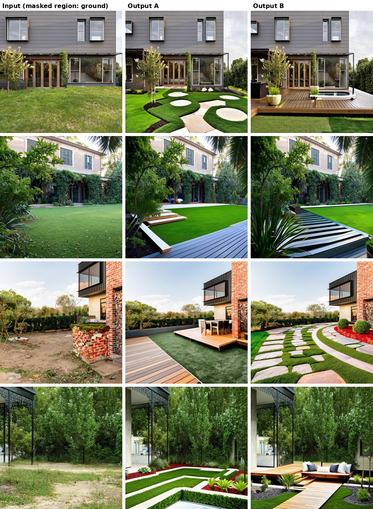

# Landscape Art Studio

Mask-guided landscape redesign with a fine-tuned Stable Diffusion 2 model.
A user uploads a photo of a yard, paints a mask over the area to redesign, picks a garden style, and the system regenerates only the masked region while keeping the house, trees and surroundings intact.

Final Year Project, FAST-NUCES Lahore (BS Data Science, 2024–25). Team: Moazzam Umer, Muhammad Arham, Abdullah Umar. Supervisor: Hamad Ul Qudous.

## Results

Input photo (left) and two outputs from the same masked region with different style prompts. The mask covers the ground area; everything outside it is preserved by the inpainting pipeline.



Individual 512×512 inputs and outputs are in [`results/`](results/).

## How the editing works

The core is **masked image-to-image inpainting** with a Stable Diffusion checkpoint fine-tuned on landscaping imagery.

1. **Input preparation.** The uploaded image and the user-drawn mask are resized to 512×512 (`backend/imagemodel.py`). The mask marks the region to regenerate; unmasked pixels are kept.
2. **Style prompt.** Each of the seven garden styles (Native Australian, Coastal, Tropical, Cottage, Formal, Modern Australian, Desert) maps to a detailed prompt template describing plant species, hard-landscaping elements and composition (`backend/promts.py`). A long negative prompt excludes people, animals, vehicles, buildings and water features so the model focuses on the landscaping itself.
3. **Masked generation.** The image, mask and prompts are sent to a Stable Diffusion img2img endpoint (`/sdapi/v1/img2img`, Automatic1111 API) running the fine-tuned checkpoint, with `denoising_strength = 0.80`, `cfg_scale = 9`, 120 steps, Euler sampler, `inpainting_fill = 1` (original content as initialisation).
4. **Upscale pass.** The result goes through a second low-denoise pass (`denoising_strength = 0.05`, 80 steps) with the SD-Upscale script and R-ESRGAN 4x+ at 2× to sharpen detail.
5. **Storage and iteration.** Outputs are stored on S3 and recorded in PostgreSQL so users can revisit, re-mask and re-edit previous results.

## The fine-tuned model

The checkpoint (`stabilityai-sd2-landscaper-v0-7`) was produced with the Hugging Face Diffusers `train_text_to_image.py` script, included in [`training/`](training/) together with the exact launch configuration.

| Setting | Value |
|---|---|
| Base model | `stabilityai/stable-diffusion-2` |
| Data | 433 captioned landscape images, Hugging Face ImageFolder format; each caption describes the visible landscaping elements |
| Trained component | U-Net denoiser only (VAE and CLIP text encoder frozen) |
| Objective | Standard diffusion noise-prediction loss conditioned on captions |
| Resolution | 512×512, centre crop, random horizontal flip |
| Steps | 500 optimisation steps |
| Batch | 1 per device × 4 gradient-accumulation steps (effective batch 4, single GPU) |
| Learning rate | 1e-5, constant, no warm-up |
| Precision | FP16, gradient checkpointing on, EMA weights on |
| Checkpoints | every 50 steps |
| Export | Full Diffusers `StableDiffusionPipeline` (DDIM scheduler, no safety checker) |

The fine-tune is small by design: its purpose was to strengthen the association between landscaping vocabulary in the prompts and the corresponding visual structures, not to learn a new domain from scratch. The seven user-facing styles are then expressed mainly through prompt templates on top of this checkpoint.

**What is not in this repo.** The 433-image training set (collected and captioned by the team) and the checkpoint weights are not included. The inference endpoint used during the project was a GPU-backed Automatic1111 server; `backend/imagemodel.py` shows the exact request payloads.

## Repository layout

```
training/      fine-tuning script and launch configuration
results/       input/output examples used in the README
backend/       FastAPI service: masking, prompt templates, SD requests, S3 and PostgreSQL persistence
frontend/      React + Tailwind UI: upload, crop, mask drawing, style selection, gallery
```

## Running the application

**Backend**

```bash
cd backend
pip install -r requirements.txt
cp constant.example.py constant.py   # fill in DATABASE_URL and BUCKET_NAME
python main.py
```

**Frontend**

```bash
cd frontend
npm install
npm start
```

The backend expects a running Stable Diffusion img2img endpoint; set its URL in `backend/imagemodel.py`.

## Technologies

Python, FastAPI, PostgreSQL, AWS S3, OpenCV, PIL · Stable Diffusion 2, Hugging Face Diffusers, Automatic1111 API · React, TailwindCSS

## License

MIT
